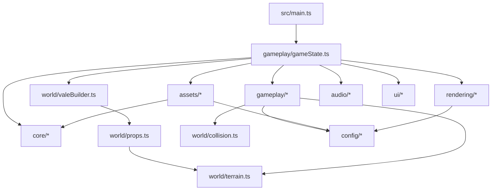
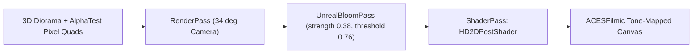

# Technical Architecture — Aethelgard Vale

This document describes the modular TypeScript architecture extracted from the original single-file prototype (`index.html`), designed for rapid expansion while preserving zero-asset HD-2D rendering and deterministic simulation.

---

## 1. Directory Structure

```text
AethelgardVale/
├── index.html                      # Thin HTML shell + HUD/overlay DOM containers
├── package.json                    # Bun scripts + Three.js & TypeScript dependencies
├── tsconfig.json                   # Strict TS configuration (noUncheckedIndexedAccess)
├── bunfig.toml                     # Bun test runner config (root = "tests")
├── scripts/
│   └── preview.ts                  # Lightweight Bun.serve static preview server for dist/
├── src/
│   ├── main.ts                     # Bootstraps and starts GameApp
│   ├── styles/
│   │   └── hud.css                 # SNES / Octopath gilded HUD & overlay styles
│   ├── core/
│   │   ├── prng.ts                 # Deterministic mulberry32 PRNG
│   │   ├── types.ts                # Shared domain types & EventBus payload map
│   │   ├── events.ts               # Typed EventBus<TEvents>
│   │   ├── gamepad.ts              # Pure radial deadzone, 8-way stick snap & standard button maps
│   │   └── input.ts                # InputManager (keyboard + gamepad polling + touch action bindings)
│   ├── config/
│   │   ├── constants.ts            # Seeds, bounds, UV scales, camera, HD-2D shader, player & combat tuning
│   │   ├── characterAppearance.ts  # Modular CharacterAppearance schema, presets & color ramps
│   │   ├── enemies.ts              # SLIME_TIERS & INITIAL_SLIME_SPAWNS
│   │   └── worldLayout.ts          # Non-overlapping PATH_SEGMENTS + prop/tree/hill coordinates
│   ├── assets/
│   │   ├── canvasUtils.ts          # Offscreen canvas helpers & NearestFilter pixel texture wrapper
│   │   ├── surfaceMaps.ts          # Toroidal Sobel normal map, heightfield & roughness texture generators
│   │   ├── environmentTextures.ts  # Procedural albedo + height/normal/roughness maps for terrain, stone, wood, water
│   │   ├── characterLayers.ts      # Detailed 24x32 semantic pixel grids (body, tunic, cloak, hair, weapon)
│   │   ├── characterComposer.ts    # Multi-layer 24x32 sprite & 24x24 portrait compositor
│   │   ├── spriteData.ts           # Compact ASCII pixel grids & palettes for slimes
│   │   └── characterSprites.ts     # Compiles hero appearance & slime sets
│   ├── audio/
│   │   ├── soundEngine.ts          # Pure Web Audio API SFX synthesizer + music transport (start/stop/pump)
│   │   ├── musicSequencer.ts       # Drift-free lookahead scheduler, MIDI/pitch helpers, VALE_LOOP pattern
│   │   └── instruments.ts          # Harp pluck, string pad, bass & percussion voices + shared delay/reverb bus
│   ├── rendering/
│   │   ├── hd2dShader.ts           # Vogel-disk Tilt-Shift DOF + split-tone grade + vignette shader
│   │   ├── reliefMaterial.ts       # Steep parallax occlusion (POM) + cavity AO MeshStandardMaterial enhancer
│   │   ├── spriteFactory.ts        # Binary alphaTest (0.5) shadow-casting 2D billboard factory
│   │   ├── renderPipeline.ts       # WebGLRenderer, Scene, PerspectiveCamera, 3-point lights, EffectComposer
│   │   └── cameraController.ts     # Diorama follow damping, screen shake, dynamic uFocusY projection
│   ├── world/
│   │   ├── terrain.ts              # Pure terrain height & cobble surface queries
│   │   ├── collision.ts            # Pure bounds, river/bridge parapet & circle obstacle resolution
│   │   ├── geometryUtils.ts        # Linear world-space & local box UV projection helpers
│   │   ├── props.ts                # Procedural 3D bridge, sanctuary rotunda, braziers, tables, chest, trees
│   │   └── valeBuilder.ts          # Assembles Aethelgard Vale scene & collision list
│   ├── gameplay/
│   │   ├── particles.ts            # 160 sunlit dust motes + material-cached burst cubes
│   │   ├── combat.ts               # Pure arc/damage/XP math + resolveSwordHits orchestrator
│   │   ├── player.ts               # PlayerController (8-way movement, animations, slash, dodge dash)
│   │   ├── enemies.ts              # EnemyManager (hop AI, squash/stretch, waves, King Slime boss)
│   │   ├── pickups.ts              # PickupManager (shared geometry/materials for gold & hearts)
│   │   └── gameState.ts            # GameApp main loop & subsystem composition
│   └── ui/
│       ├── floatingText.ts         # World-to-screen projected floating damage/heal/XP numbers
│       ├── minimap.ts              # Circular Octopath-style minimap renderer
│       └── hud.ts                  # Portrait blit, HP/XP bars, toggles, banner toast, overlays
└── tests/
    ├── prng.test.ts
    ├── terrain.test.ts
    ├── collision.test.ts
    └── combat.test.ts
```

---

## 2. Module Dependency Graph



---

## 3. HD-2D Render Pipeline



Key rendering parameters (`src/rendering/renderPipeline.ts` & `src/rendering/hd2dShader.ts`):
- **Renderer**: `PCFSoftShadowMap`, `ACESFilmicToneMapping` (exposure `1.08`), pixel ratio capped at `2`.
- **Lighting**: Cool sky `HemisphereLight` (`#bfd9eb` / `#3b3224`), warm golden `DirectionalLight` (`#fff0c9`, `2048x2048` shadow map), subtle warm back `rimLight` (`#f2b672`), plus flickering orange `PointLight`s on stone braziers.
- **Dynamic Tilt-Shift Focus**: Each frame, `CameraController.update()` projects the hero's world position into NDC space and updates `uFocusY` (clamped to `[0.32, 0.66]`), keeping the player's horizontal band razor-sharp while foreground silhouettes and distant hills blur via a 12-tap Vogel-disk bokeh kernel.

---

## 4. Frame Execution Order (`GameApp.start`)

1. Compute clamped `rawDt = Math.min(clock.getDelta(), 0.05)` and advance `elapsed`.
2. **Hitstop Gate**: If `hitstopTimer > 0`, decrement `hitstopTimer`, call `pipeline.render()`, and return early (freezing simulation while keeping the frame crisp).
3. If `gameStarted`:
   - `input.update()` — samples the first standard-mapping gamepad (stick deadzone, D-pad, button rising edges) before movement is read.
   - `player.update(...)` — 8-way input, dash or movement, terrain height, sprite frame, active slash hit detection (`resolveSwordHits`).
   - Proximity check for the Sanctuary Chest prompt.
   - `enemies.update(...)` — slime hop AI, knockback decay, squash-and-stretch, player contact damage, wave respawns, and King Slime boss spawn at `10` kills.
   - `pickups.update(...)` — spin/bob animation and magnetic collection within `1.05` units.
   - `minimap.draw(...)` — renders river, bridge, sanctuary arc, chest, slimes, and hero heading.
4. `updateAtmosphereAndFX(rawDt)` — scrolls river water UVs, cycles brazier flame frames/flicker, updates dust motes & burst cubes, projects floating damage numbers, ticks banner toast timer.
5. `cameraController.update(...)` — exponential follow damping, screen shake decay, `uFocusY` shader uniform update.
6. `pipeline.render()` — executes `EffectComposer`.

---

## 5. Memory & Resource Lifecycle Rules

- **Particle Burst Materials**: `ParticleSystem` caches `THREE.MeshBasicMaterial` instances by hex color in a `Map` and shares a single `BoxGeometry(0.14, 0.14, 0.14)` across all burst particles.
- **Pickups**: `PickupManager` shares one `OctahedronGeometry` and two cached materials (`goldMat`, `heartMat`).
- **Enemy Sprites**: Each `SlimeEntity` owns its own `MeshStandardMaterial` so hit-flash `emissive` pulses do not bleed across other slimes; `EnemyManager.removeSlimeAt` and `clear()` explicitly dispose geometry and material on removal.
- **Music Session**: `SoundEngine.startMusic()` builds a single delay/reverb bus and lookahead scheduler per session; `stopMusic()` clears the tick timer before any further notes are scheduled, and `dispose()` disconnects every bus node and closes the `AudioContext`.
- **Clean Reset**: `GameApp.resetGame()` clears pickups, burst particles, floating DOM text nodes, hitstop, shake, and respawns enemies deterministically without reloading the page.

---

## 6. EventBus Contract (`src/core/types.ts`)

| Event | Payload | Consumers |
| --- | --- | --- |
| `stats:changed` | `PlayerStatsSnapshot` | `HudController.updateStats` |
| `banner:show` | `{ message, duration }` | `HudController.showBanner` |
| `player:died` | `{ slimesDefeated, lvl }` | `HudController.showGameOver` |
| `boss:spawned` | `{ tier }` | Future audio/UI hooks |
| `boss:defeated` | `{ tier }` | Future quest/victory hooks |
| `chest:opened` | `{ goldBonus, atkBonus }` | Future inventory/quest hooks |
